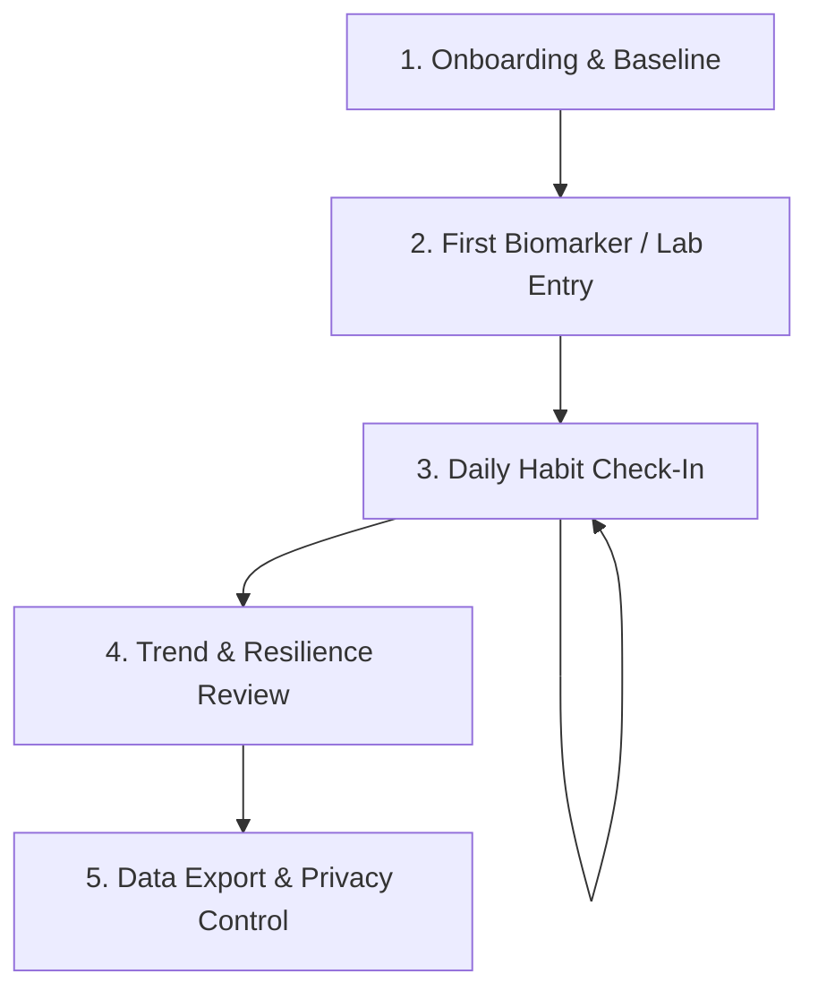

# MetaboAge — MVP Product Requirements Document (PRD)

**Document ID:** MTA-DOC-03  
**Task:** MTA-02 (CollabSphere Task #6)  
**Status:** In Progress / Ready for Review  
**Date:** 2026-10-20  
**Target Release:** MVP v1.0.0  

---

## 1. Executive Summary & Goals

### 1.1 Objective
MetaboAge MVP delivers a focused, privacy-first metabolic health companion. It empowers health-conscious individuals to bridge the gap between infrequent annual blood tests and daily lifestyle habits by providing seamless manual biomarker tracking, daily habit logging, and longitudinal trend visualization.

### 1.2 Core Product Principles
1. **Evidence-Based & Non-Diagnostic:** Anchor scoring to established consensus ranges (ADA/AHA) without providing clinical medical diagnoses or speculative biological-age numbers.
2. **Low-Friction Habit Loop:** Quick daily logging (< 30 seconds) that reinforces positive behavioral momentum.
3. **Transparent Data Integrity:** Honest visual representations that clearly separate missing/unlogged data from true zero values.
4. **Absolute Privacy:** User-owned data with friction-free one-click export and permanent hard deletion.

---

## 2. Target Personas & Core Journeys

### 2.1 Personas

#### Persona A: Alex — "The Proactive Preventer" (Primary)
- **Demographics:** Age 34, Senior Software Engineer, tech-literate, health-conscious.
- **Context:** Has familial hypertension and early Type 2 diabetes. Receives annual employer health screenings (lipid panel, fasting blood glucose).
- **Goal:** Wants to observe whether intermittent fasting and postprandial walking actually blunt glucose volatility and improve lipid ratios between annual checks.
- **Pain Point:** Annual lab PDFs end up forgotten in email attachments; fitness trackers don't accept blood lab data.

#### Persona B: Elena — "The Habit Seeker" (Secondary)
- **Demographics:** Age 46, Marketing Consultant.
- **Context:** Annual checkup showed borderline fasting glucose ($104\text{ mg/dL}$) and borderline blood pressure ($132/86\text{ mmHg}$).
- **Goal:** Needs an approachable, non-stigmatizing interface to record daily walking and fasting habits without feeling medicalized or anxious.
- **Pain Point:** Commercial apps either cost $400/year or try to sell continuous wearable sensors that cause skin irritation.

---

### 2.2 Core User Journeys

1. **Journey 1: Onboarding & Baseline Setup:**
   User enters basic demographic context (birth year, biological sex for lab reference ranges, height, baseline weight). No invasive questionnaires or forced account creation for local exploration.
2. **Journey 2: Lab Marker Entry:**
   User enters blood biomarker values from their latest lab report. Units are auto-detected with clear toggles (e.g., $\text{mg/dL}$ vs $\text{mmol/L}$). Values outside plausible biological bounds are caught with polite validation.
3. **Journey 3: Daily Habit Logging:**
   Every evening or morning, the user logs 3 core habits: fasting window duration (hours), physical activity/movement (minutes or steps), and sleep duration/quality. Completed in under 30 seconds.
4. **Journey 4: Longitudinal Trend Review:**
   User views interactive charts displaying biomarker history overlaid with habit consistency streaks. Clear visual differentiation between days with missing data and days with zero activity.
5. **Journey 5: Data Management & Export:**
   User navigates to settings to export complete health records as clean JSON or CSV, or executes a one-click irreversible data wipe.

---

## 3. Scope Boundaries

| Category | In-Scope (MVP) | Out-of-Scope (Excluded from MVP) |
| :--- | :--- | :--- |
| **Biomarkers** | Manual entry of fasting glucose, HbA1c, triglycerides, HDL, LDL, total cholesterol, resting blood pressure, waist circumference. | Automated optical character recognition (OCR) of lab PDFs, direct phlebotomy/lab API integrations. |
| **Scoring** | Metabolic Resilience Wellness Score (0–100 educational index based on consensus ranges). | **Biological-age scoring (e.g. "You are 42.5 biological years old"), epigenetic clock claims.** |
| **Clinical Status** | Guideline comparisons (e.g. "Within standard ADA normal fasting range"). | **Diagnostic claims (e.g. "You have prediabetes"), prescription or medication advice.** |
| **Habits** | Manual logging of fasting window (hrs), daily movement (mins/steps), sleep (hrs). | Real-time continuous sensor Bluetooth streaming, camera-based meal recognition. |
| **Data & Auth** | Local-first storage with optional secure user account; JSON/CSV export; account/data wipe. | Social sharing feeds, public leaderboards, third-party advertising tracking. |

---

## 4. Functional Requirements (P0)

### REQ-01: User Profile & Physiological Baseline
- **Description:** Store baseline parameters required to establish appropriate clinical reference ranges.
- **Inputs:** Birth date/year, biological sex (Male/Female/Unspecified), height (cm/in), weight (kg/lb).
- **Acceptance Criteria:**
  - Plausible physiological ranges enforced (e.g., weight: $30\text{ kg} - 350\text{ kg}$, height: $100\text{ cm} - 250\text{ cm}$).
  - Unit conversions (Metric $\leftrightarrow$ Imperial) calculate deterministically without rounding drift.
  - Profile can be updated at any time with timestamped history.

### REQ-02: Manual Metabolic Biomarker Ingestion
- **Description:** Capture key metabolic syndrome indicators with date and time of test.
- **Supported Biomarkers & Clinical Bounds:**
  - Fasting Glucose: $40 - 500\text{ mg/dL}$ ($2.2 - 27.8\text{ mmol/L}$)
  - HbA1c: $3.5\% - 16.0\%$
  - Triglycerides: $30 - 1500\text{ mg/dL}$
  - HDL Cholesterol: $10 - 150\text{ mg/dL}$
  - LDL Cholesterol: $20 - 400\text{ mg/dL}$
  - Resting Blood Pressure: Systolic $70 - 240\text{ mmHg}$, Diastolic $40 - 140\text{ mmHg}$
  - Waist Circumference: $40 - 200\text{ cm}$ ($16 - 80\text{ in}$)
- **Acceptance Criteria:**
  - User can log partial panels (e.g., only glucose and blood pressure if lipid panel was not tested).
  - Out-of-bounds inputs display immediate, non-blocking warning confirmations to prevent typos.
  - Standard reference ranges (ADA/AHA) are displayed as subtle visual benchmarks without alarmist text.

### REQ-03: Daily Lifestyle Habit Tracking
- **Description:** Rapid check-in for daily behaviors that directly modulate metabolic health.
- **Habit Metrics:**
  - Overnight Fasting Window: $0 - 24\text{ hours}$ (e.g., 14:10 or 16:8 tracking).
  - Movement / Exercise: $0 - 360\text{ minutes}$ of intentional movement (or daily steps).
  - Sleep Duration & Perceived Quality: $0 - 18\text{ hours}$, rating (1 to 5 stars).
- **Acceptance Criteria:**
  - Daily check-in interface requires $\le 3$ clicks/taps to submit.
  - Supports quick retrospective logging up to 7 days prior.
  - Submitting daily log updates daily streak counter immediately.

### REQ-04: Multi-Variate Longitudinal Trend Visualization
- **Description:** Interactive graphical representation of biomarker records and daily habit compliance over time.
- **Time Windows:** 7 Days, 30 Days, 90 Days, 1 Year, All Time.
- **Acceptance Criteria:**
  - **Zero vs. Missing Data Distinction:** Days without logs are rendered as breaks or dashed bridges; zero values (e.g., 0 minutes of exercise) are rendered explicitly at baseline $y=0$.
  - Dual-axis or synchronized stacked charts correlate habit frequency against biomarker trajectory.
  - Hover/tap reveals precise numerical values, measurement date, and guideline band.

### REQ-05: Metabolic Resilience Wellness Index
- **Description:** A normalized 0–100 wellness score synthesizing logged biomarkers against consensus guidelines (Alberti et al., 2009).
- **Acceptance Criteria:**
  - Computation is 100% deterministic: identical inputs yield identical scores across all client/server platforms.
  - Missing biomarker parameters are gracefully handled using normalized sub-indices without artificially penalizing the user for unmeasured labs.
  - **Zero biological-age or clinical diagnostic claims:** The UI must display an explicit educational disclaimer: *"Educational wellness index. Not medical advice or biological age diagnostic."*

### REQ-06: Privacy, Data Export & Deletion
- **Description:** Complete user sovereignty over health data.
- **Acceptance Criteria:**
  - **Export:** Single-click "Export My Data" generates a standard ZIP containing clean `metabolic_biomarkers.csv`, `daily_habits.csv`, and a complete `metaboage_backup.json`.
  - **Hard Deletion:** "Delete All Data" prompts for explicit confirmation, immediately purges all local storage and database records, and terminates the session.
  - **Telemetry Isolation:** Zero third-party analytics (Google Analytics, Meta Pixel, Mixpanel) permitted on pages containing health metrics.

---

## 5. Non-Functional Requirements (P0)

1. **Performance:**
   - Initial application load time under $1.2\text{ seconds}$ on standard 4G connections.
   - Interactive chart redraw and filter switching latency under $100\text{ ms}$.
2. **Security & Cryptography:**
   - All network communication enforced over TLS 1.3.
   - User health records stored with column/row-level encryption or client-side encrypted vaults.
   - No sensitive biomarkers logged to standard console logs or remote error monitoring payloads.
3. **Responsive Design & Accessibility:**
   - Full responsive layout support from $360\text{px}$ mobile screens up to $4\text{K}$ desktops.
   - WCAG 2.1 Level AA compliance with high-contrast text ratios ($\ge 4.5:1$).
   - Screen-reader accessible form labels and chart data tables.
