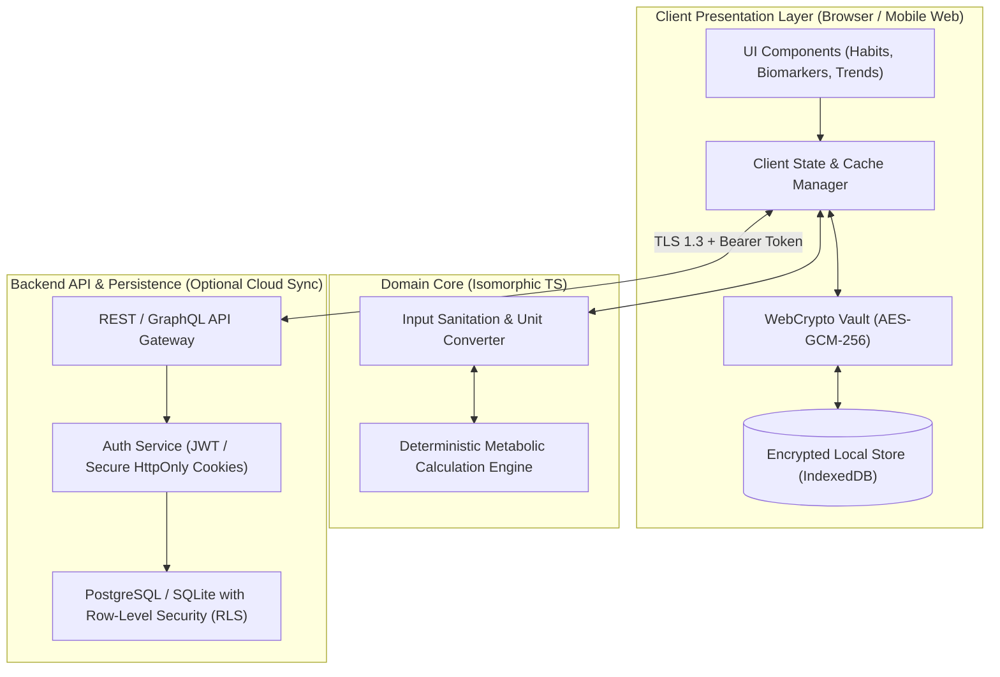
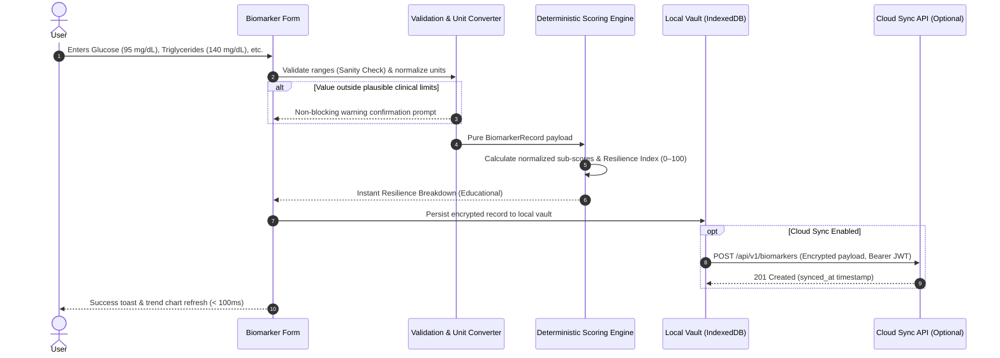

# MetaboAge — Technical Architecture Specification

**Document ID:** MTA-DOC-05  
**Task:** MTA-05 (CollabSphere Task #9)  
**Status:** In Progress / Ready for Review  
**Date:** 2026-10-20  
**Target System:** MetaboAge Web & API  

---

## 1. System Overview & Architectural Patterns

MetaboAge is designed around a **Modular, Local-First, Privacy-Isolated Architecture**. The architecture prioritizes sub-second responsiveness, absolute data determinism, and user privacy over complex distributed microservices.

### 1.1 Core Principles
1. **Decoupled Calculation Engine:** Health biomarker math and resilience scoring are implemented as pure, side-effect-free deterministic functions, isolated from UI rendering and network I/O.
2. **Local-First Resilience:** Daily habit logging and trend inspection operate seamlessly offline or on high-latency mobile connections using encrypted client storage (IndexedDB + WebCrypto) with background sync.
3. **Zero-Trust PHI Isolation:** Biomarker and health data are quarantined from analytics, telemetry, and external third-party CDNs. Database access is guarded by cryptographic row-level isolation.

---

## 2. Architecture & Data Flow Diagrams

### 2.1 High-Level Component Topology



---

### 2.2 Data Flow: Biomarker Ingestion & Resilience Calculation



---

## 3. Database Schema & Data Models

### 3.1 Relational Schema (PostgreSQL DDL / SQLite Compatible)

```sql
-- 1. Users Table (Core baseline metadata)
CREATE TABLE users (
    id UUID PRIMARY KEY DEFAULT gen_random_uuid(),
    created_at TIMESTAMPTZ NOT NULL DEFAULT NOW(),
    updated_at TIMESTAMPTZ NOT NULL DEFAULT NOW(),
    birth_year SMALLINT NOT NULL CHECK (birth_year BETWEEN 1900 AND 2026),
    biological_sex VARCHAR(16) NOT NULL CHECK (biological_sex IN ('male', 'female', 'unspecified')),
    height_cm NUMERIC(5, 2) CHECK (height_cm BETWEEN 80.0 AND 250.0),
    preferred_unit_system VARCHAR(8) NOT NULL DEFAULT 'metric' CHECK (preferred_unit_system IN ('metric', 'imperial'))
);

-- 2. Biomarker Records Table (Lab test results)
CREATE TABLE biomarker_records (
    id UUID PRIMARY KEY DEFAULT gen_random_uuid(),
    user_id UUID NOT NULL REFERENCES users(id) ON DELETE CASCADE,
    recorded_at DATE NOT NULL,
    created_at TIMESTAMPTZ NOT NULL DEFAULT NOW(),
    fasting_glucose_mgdl NUMERIC(5, 1) CHECK (fasting_glucose_mgdl BETWEEN 30.0 AND 600.0),
    hba1c_pct NUMERIC(4, 2) CHECK (hba1c_pct BETWEEN 3.0 AND 18.0),
    triglycerides_mgdl NUMERIC(6, 1) CHECK (triglycerides_mgdl BETWEEN 20.0 AND 2000.0),
    hdl_cholesterol_mgdl NUMERIC(5, 1) CHECK (hdl_cholesterol_mgdl BETWEEN 10.0 AND 200.0),
    ldl_cholesterol_mgdl NUMERIC(5, 1) CHECK (ldl_cholesterol_mgdl BETWEEN 20.0 AND 500.0),
    systolic_bp_mmhg SMALLINT CHECK (systolic_bp_mmhg BETWEEN 60 AND 260),
    diastolic_bp_mmhg SMALLINT CHECK (diastolic_bp_mmhg BETWEEN 40 AND 160),
    waist_circumference_cm NUMERIC(5, 2) CHECK (waist_circumference_cm BETWEEN 40.0 AND 220.0),
    source_notes TEXT,
    CONSTRAINT unique_user_biomarker_date UNIQUE(user_id, recorded_at)
);

-- 3. Daily Habits Table (Lightweight daily logs)
CREATE TABLE daily_habits (
    id UUID PRIMARY KEY DEFAULT gen_random_uuid(),
    user_id UUID NOT NULL REFERENCES users(id) ON DELETE CASCADE,
    log_date DATE NOT NULL,
    created_at TIMESTAMPTZ NOT NULL DEFAULT NOW(),
    fasting_window_minutes SMALLINT CHECK (fasting_window_minutes BETWEEN 0 AND 1440),
    movement_minutes SMALLINT CHECK (movement_minutes BETWEEN 0 AND 720),
    sleep_minutes SMALLINT CHECK (sleep_minutes BETWEEN 0 AND 1080),
    sleep_quality_rating SMALLINT CHECK (sleep_quality_rating BETWEEN 1 AND 5),
    CONSTRAINT unique_user_habit_date UNIQUE(user_id, log_date)
);

-- 4. Row-Level Security (RLS) Policies
ALTER TABLE biomarker_records ENABLE ROW LEVEL SECURITY;
ALTER TABLE daily_habits ENABLE ROW LEVEL SECURITY;

CREATE POLICY user_biomarker_isolation ON biomarker_records
    FOR ALL
    USING (user_id = current_setting('app.current_user_id')::UUID);

CREATE POLICY user_habit_isolation ON daily_habits
    FOR ALL
    USING (user_id = current_setting('app.current_user_id')::UUID);
```

---

## 4. API Contracts & Calculation Engine Interface

### 4.1 TypeScript Engine Interface (`metabolic-engine.ts`)

```typescript
export interface BiomarkerRecord {
  fastingGlucoseMgDl?: number;
  hba1c?: number;
  triglyceridesMgDl?: number;
  hdlMgDl?: number;
  ldlMgDl?: number;
  systolicBp?: number;
  diastolicBp?: number;
  waistCircumferenceCm?: number;
}

export interface HabitSummary {
  avgFastingHours7d: number;
  avgMovementMinutes7d: number;
  avgSleepHours7d: number;
}

export interface ResilienceScoreResult {
  resilienceScore: number; // 0 - 100
  riskTier: 'optimal' | 'moderate' | 'elevated' | 'insufficient_data';
  subScores: {
    glycemic: number | null;
    lipid: number | null;
    cardiovascular: number | null;
    lifestyleBonus: number;
  };
  disclaimer: string;
}

/**
 * Pure, deterministic calculation function.
 * Must produce identical outputs in node, browser, and edge workers.
 */
export function calculateMetabolicResilience(
  biomarkers: BiomarkerRecord,
  habits?: HabitSummary
): ResilienceScoreResult;
```

### 4.2 REST Endpoints

| Endpoint | Method | Request Payload | Response Payload | Description |
| :--- | :---: | :--- | :--- | :--- |
| `/api/v1/biomarkers` | `POST` | `BiomarkerRecordDTO` | `{ id, recorded_at, resilienceScore }` | Record new lab entry with instant score |
| `/api/v1/biomarkers` | `GET` | `?from=YYYY-MM-DD&to=...` | `BiomarkerRecordDTO[]` | Retrieve historical lab biomarker trends |
| `/api/v1/habits` | `POST` | `{ log_date, fasting_minutes, movement_minutes, sleep_minutes }` | `{ id, streak_count }` | Log daily habits (< 30s workflow) |
| `/api/v1/habits` | `GET` | `?days=30` | `DailyHabitDTO[]` | Retrieve daily habit compliance streak |
| `/api/v1/export` | `GET` | `None` | `application/zip` (CSV + JSON) | One-click complete health data export |
| `/api/v1/account` | `DELETE`| `{ confirm_phrase: "DELETE" }` | `{ status: "PURGED" }` | Hard wipe of all user records |

---

## 5. Authentication, Privacy & Data Isolation

1. **Authentication:**
   - Stateless JWT with short expiration (15 minutes) and secure `HttpOnly`, `SameSite=Strict` refresh tokens.
   - Anonymous Local Mode: MetaboAge can run 100% locally in-browser without account registration; credentials and cloud sync are strictly opt-in.
2. **User Data Isolation:**
   - PostgreSQL Row-Level Security (RLS) ensures tenant isolation at the query execution level, preventing cross-tenant leakage even in the event of an application SQL error.
3. **Audit Log & Telemetry Privacy:**
   - Strict PHI redaction: Health biomarkers (`fasting_glucose`, `blood_pressure`) are never written to server access logs or telemetry sinks.

---

## 6. Technology Choices & Trade-off Matrix

| Layer | Selected Technology | Alternative Considered | Rationale & Trade-offs |
| :--- | :--- | :--- | :--- |
| **Frontend Runtime** | **Vite + React (TypeScript) + Vanilla CSS** | Next.js (SSR) / Angular | Instant hot reload, zero hydration lag, full offline client capability, minimal bundle footprint (< 90KB gzipped) compared to heavy SSR frameworks. |
| **Styling & Design** | **Tailored Vanilla CSS (Custom Design System)** | TailwindCSS | Complete control over CSS variables, theme switching (dark/light), smooth 60fps micro-animations, zero arbitrary build dependencies. |
| **Visualization** | **Lightweight SVG / Canvas Chart Engine** | Highcharts / Chart.js | Custom rendering guarantees distinct handling of zero values vs missing/unlogged data without bulky 300KB chart libraries. |
| **Storage Engine** | **PostgreSQL (with RLS) + IndexedDB (Local)** | MongoDB / DynamoDB | Strict relational schema integrity for longitudinal date-indexed health records; RLS provides military-grade user data isolation. |
